# The Merit Field (Tsok Zhing) of the Menri Tradition: combined lineage entries

Compiled 2026-10-04 from ten posts of the "Field of Accumulation" series on https://ravencypresswood.com/ (Nine Ways, Raven Cypress Wood; each post is marked "All Rights Reserved" by the author). Text and images are unaltered copies of the site's content; this file is a working copy for planning an interactive version of the tree, not a published document. Permission to republish has not been confirmed.

## Contents

1. Abbots of Menri Monastery
2. The Aural Transmission of Zhang Zhung
3. The Lineage of the Three-fold Cycle of Dzogchen Proclamations
4. The Lineage of the Profound Guidance through AH
5. The Lamas of Pure Discipline, The Monastic Lineage
6. Lamas of the Renowned Three Cycles of Secret Mantra
7. The Gathering of Buddhas
8. The Yungdrung Sempa
9. The Ocean of Khandro
10. The Yidams

## The tree

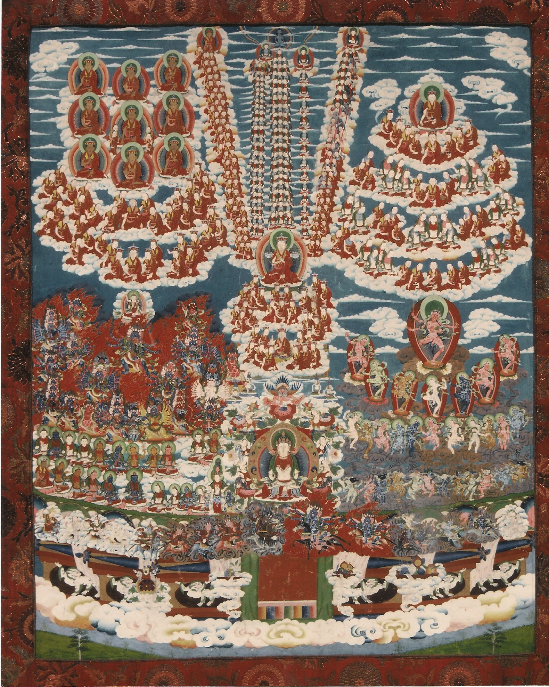

Master numbering diagram (1–343, the layout all section diagrams share):

## Numbering caveat

The posts use two numbering schemes. The abbots post (1–34) and the Gathering of Buddhas post (235–249) use the master numbers shown above. The other posts number their own section from 1 (for example the Dzogchen proclamations 1–28 and the Khandro 1–25), and the Yidams post follows its own list. Mapping a section-local number to a master position needs the highlighted section diagram printed in each section below.

---

## 1. Abbots of Menri Monastery

Source: <https://ravencypresswood.com/2014/12/06/the-field-of-accumulation-abbots-of-menri-monastery/> · published 2014-12-06 · master numbers 1–34

The Yungdrung Bon Merit Field of the Menri Tradition

In the Yungdrung Bön tradition, the place where the deities and objects of veneration are gathered is called the “Tsok Zhing”, the “Field of Accumulation”.  It is also sometimes translated as the “Field of Merit” or the “Merit Field” because what is being accumulated by paying homage and making offerings to this place is merit, or virtue.  The Merit Field consists of the images of the enlightened deities and protectors which represent Enlightened Body, chortens which represent Enlightened Mind, and scriptures and the sound of mantra which represent Enlightened Speech.  The lower section of the Merit Field also contains unenlightened but powerful and worldly protectors that are oath bound to protect the Yungdrung Bön.  There are many different depictions of the Merit Field according to different lineages.  However, the most well-known image is the Merit Field according to the tradition of Menri Monastery.   The Merit Field is depicted in a very specific way and this is the proper guide for a practitioner’s visualization.  

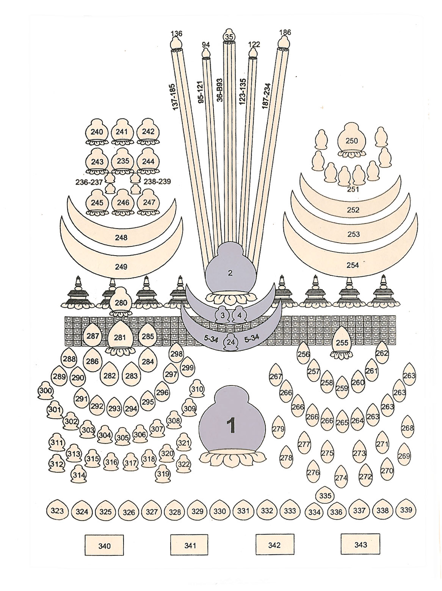

Because this Merit Field is based upon the Menri tradition, the central figures are primarily associated with the Menri Monastery.

1. The glorious teacher who has blessings and who has the nature of all of the collective Victorious Ones, the all-good essence of the kind root lama, Shenlha Ökar.  He has the 25 mudra of the Perfected Enjoyment Body.  He wears the  13 peaceful ornaments and has the 9 ways of purity.  He has the 32 major marks and the 80 minor marks.  He has the 40 items of nobility and he radiates forth a million rays of light.

2-34 are the abbots of Menri Monastery.  Beside each of the names is the year in which they became abbot of Menri Monastery.

2. The one who united the three transmissions, the Second Buddha, Nyammé Sherap Gyaltsen.  He has the appearance of a fully ordained monk.  He held the knowledge of the doors of Bön without any exceptions.  He was the abbot of the prestigious Yeru Wensaka Monastery in Tsang, Tibet.  It was destroyed by a flood and mudslide in 1386.  In 1405, he established Tashi Menri Monastery according to the Bön Dru lineage with artifacts that he had recovered from the ruins of Yeru Wensaka.  At its height, Tashi Menri Monastery could house over 300 monks and had four colleges.  It was completely destroyed during the Chinese invasion in 1966.

3. The regent of the Guide who was the Second Buddha, Rinchen Gyaltsen.  He became abbot in 1415.

4. The great abbot, Namkha Yeshé, 1446

5. Künzang Gyalten, 1464

6. Tenzin Rinchen Gyaltsen, 1485

7. Tsultrim Gyaltsen, 1511

8. Sonam Yeshé, 1532

9. Sonam Yundrung, 1575

10. Shétsu Drungmu, 1610

11. Shérab Özer, 1647

12. Yungdrung Gyaltsen, 1662

13. Shérab Lodro, 1677

14. Shérab Özer, 1686

15. Tsukpü Özer, 1697

16. Yungdrung Tsultrim, 1706

17. Rinchen Özer, 1722

18. Rinchen Lhundrup, 1735

19. Sherap Tenzin, 1760

20. Shérap Wangyal, 1776

21. Yungdrung Wangyal, 1789

22. Püntsok Namgyal, 1805

23. Sonam Lodro, also known as Sherap Gong Gyal, 1810

24. Nangton Dawa Gyaltsen, also known as Sonam Gyaltsen.  In 1834, he founded the renowned Yungdrung Ling Monastery.

25. Nyima Tenzin, 1836.  He was also one of the main teachers of Yungdrung Ling Monastery.

26. Sonam Püntsok,

27. Shérap Yungdrung

28. Sangye Tenzin

29. Tenzin Tsultrim

30. Püntsok Lodro

31. Gyalwa Lodro

32. Tenpa Lodro

33. Nyima Wangyal

34. Sherap Lodro.  He is the first abbot of Menri Monastery in Dolanji, India. 1968.  Upon ordination as the 33rd throne-holder of Menri Monastery, he was given the name Lungtok Tenpé Nyima.

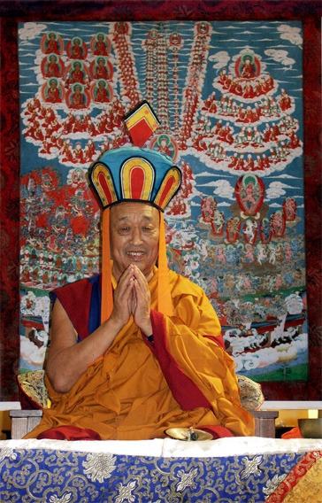
The 33rd Holder of the Golden Throne of Menri Monastery, His Holiness Lungtok Tenpe Nyima Rinpoche

(This blog is offered for free to the worldwide students of Yungdrung Bön.  It is made possible by readers like you.  If you would like to join in making a gift of support for this blog or the translation work of Raven Cypress Wood, please go to https://www.paypal.com/home, click ‘Send’ and use Raven’s account rcw108@gmail.com.  Any amount is of great support!)

---

## 2. The Aural Transmission of Zhang Zhung

Source: <https://ravencypresswood.com/2015/01/18/the-field-of-accumulation-the-aural-transmission-of-zhang-zhung/> · published 2015-01-18

Tsok zhing according to MenriThe Yungdrung Bon Merit Field of the Menri Tradition

In the Yungdrung Bön tradition, the place where the deities and objects of veneration are gathered is called the “Tsok Zhing”, the “Field of Accumulation”.  It is also sometimes translated as the “Field of Merit” or the “Merit Field” because what is being accumulated by paying homage and making offerings to this place is merit, or virtue.  This is the Merit Field according to the Menri Tradition from a drawing done by the great master and scholar HE Yongdzin Tenzin Namdak Rinpoche.

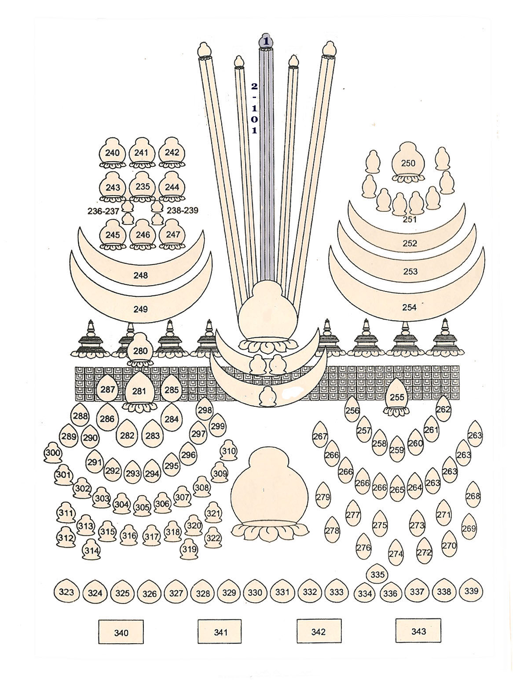
#1-101 depicts the Aural Lineage of Zhang Zhung, the Zhang Zhung Nyen Gyü. This lineage of Dzogchen teachings is continuous and unbroken.

#1-9 are the Nine Divine Beings of the Mind to Mind Transmission. These Beings transmitted the teachings by way of intrinsic awareness, rikpa.

1. The source of the lineage, the teacher Küntu Zangpo. This is the Bönku. He is naked and without ornamentation.

2. Shenlha Ökar, the pure, white light deity of compassion. This is the Dzok ku. His compassion is all-pervasive and he is the embodiment of exalted, positive qualities.

3. Gyalwa Shenrap, the divine being that descended to the human realm in order to guide sentient beings. This is the Tulku and he became known as the Lord Tönpa Shenrap Miwoché.

4. Tsemé Öden, the divine being that emanated into a god realm in order to guide bodhisattvas.

5. Trulshen Nangden, the divine being that emanated into a god realm from the mind of Küntu Zangpo.

6. Barnang Khujuk, the divine being that emanated into a god realm from the speech of Küntu Zangpo

7. Zangza Ringtsun, a divine emanation of the Great Mother Sherap Chamma and the divine mother of Chimé Tsukpü. Trulshen nangden descended upon her right shoulder in the form of a turquoise cuckoo and caused a subtle, internal heat. One year later, she gave birth to Chimé Tsukpü. Her body color is golden and she holds a golden vase in her right hand and a golden mala in her left hand.

8. Chimé Tsukpü, He is turquoise in color. Nine days after his birth, his mother Zangza Ringtsun found him suspended in space and radiating light. He taught both tantra and Dzogchen.

The beginning of the Aural Transmission Lineage

9. Sangwa Düpa, He received the transmission through rikpa and was the first to use speech as well as awareness to transmit the teachings. He was born a prince of Tazik and began the transmission among human beings. Because he was the first to use speech to transmit the teachings, he is also known as The Teacher of the Aural Transmission Lineage.

#10-33 The 24 Masters of the Aural Transmission Lineage of Zhang Zhung

These 24 Masters were all from the ancient kingdom of Zhang Zhung and used speech to transmit the teachings. Each of them attained the full realization of Dzogchen and displayed that realization by attaining the rainbow body of light. These 24 masters are divided into 4 groups.

#10-14 The Five Beyond-All Masters

#15-20 The Six Masters who show the Six Meanings of Dzogchen

#21-29 The Nine Masters of Experience Within

#30-33 The Four Masters of Ürgyen

The Five Beyond-All Masters

- Lhabön Yongsu Dakpa, He received the transmission from Sangwa Düpa and spread the teachings in the god realm.

- Lübön Banam, He received the transmission from Sangwa Düpa and spread the teachings in the lü (Sanskrit. naga) realm.

- Mibön Tridé Zambu, He received the transmission from Sangwa Düpa and spread the teachings in the human realm.

- Banam Kyolpo

- Trisho Gyalwa, He was the son of Banam Kyolpo.

The Six Masters who show the Six Meanings of Dzogchen

- Rasang Bönpo Samdrup

- Darma Sherap

- Darma Bodé

- Zhang Zhung Bönpo Tripén

- Muyé Lhagyung

- Mashen Lézang

The Nine Masters of Experience Within

- Gyershen Taklha

- Rasang Bönpo Yungdrung Se

- Séchen Yungdrung Pén

- Gébar Döndrup

- Gyerpung Gépén

- Dése Gégyal

- Zhang Zhung Namgyal

- Muyé Lhagyung Karpo

- Shen Horti Chenpo

The Four Ürgyen Masters

- Shen Dönkün Druppa

- Rasang Bönpo Péngyal

- Gurip Sega

- Dawa Gyaltsen

- Tapihritsa, He was born into a nomadic family in the country of Zhang Zhung. He practiced at a place near Mt. Tise known as Sengé Tap. He practiced for nine years without interrupting it with ordinary, human speech. He achieved the rainbow body of light. After this, Tapihritsa manifested as a young boy and began working as a shepherd for a wealthy man in the area where Nangzher Lopo was practicing. Upon meeting, Nangzher Lopo asked the boy a series of questions and became annoyed at his answers. Challenging him to debate in front of the Zhang Zhung king, the boy laughed and began speaking about the true nature of mind. Realizing that this was an emanation and not an ordinary boy, Nangzher Lopo fainted. Regaining consciousness, he saw that the boy had transformed and was showing a clear and luminous body surrounded by a rainbow and suspended in space.

- Gyerpung Nangzher Lopo, He extensively practiced the cycles of Zhang Zhung Meri and Gekho. In doing so, he acquired great magical power. He was the priest for the Zhang Zhung king and was well-known throughout the kingdom. Because of his devotion, he met and received teachings from Tapihritsa 3 times. He lived for 573 years.

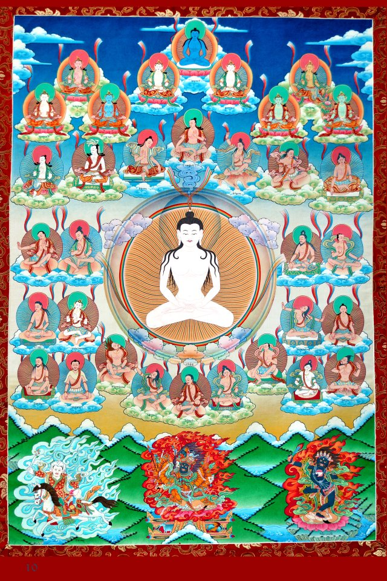
Lineage Masters of the Aural Transmission of Zhang Zhang prior to the 8th Century

The Six Yogis from Zhang Zhung

- Gyalzik Sechung, He first received these teachings when he was 72 years old. He lived for 317 years and attained the rainbow body of light.

- Mu Shen Tsogé, At the age of 3, Nangzher Lopo identified him as a qualified student and he received the teachings at the age of 19. He lived for 173 years and attained the rainbow body of light.

- Mu Gyershen Tsotang, He lived for 113 years and attained the rainbow body of light.

- Mu Shotram Chenpo, He lived for 117 years and attained the rainbow body.

- Mu Gyalwa Lodro, He was attendant to Mu Shotram Chenpo for nine years before he received teachings. He lived for 270 years and attained the rainbow body of light.

- Pongyal Tsenpo, also known as Ponchen Tsenpo, He purified all the defilements of his physical body and therefore it was not necessary for him to eat food for nourishment. He lived for 1,600 years and his body showed no signs of aging. He then transformed himself into a turquoise cuckoo and flew off towards the southwest in order to subdue demons.

Here, the lineage splits into Upper & Lower systems of transmission according to the geographical location in which it was transmitted.

The Upper System of Transmission

The Six Realized Sages

To these disciples was transmitted the Four Cycles of the Precepts Transmission (the Ka Gyü Kor Zhi), but not the Experiential Transmission (the Nyam Gyü).

- Gugé Loden, He received the teachings from Pöngyal Tsenpo in an area near Mount Tisé. As a youth, he worked as a goatherd and had often dreamt of a blue cuckoo speaking to him. One day, he watched as a cuckoo descended from the sky near him. Going closer, instead of a bird, he found a yogi in a blue robe. This was Pöngyal Tsenpo.

- Pureng Kunga, He practiced in the area of Mount Tisé. By following his lama’s guidance on Dzogchen, he attained realization in one month.

- Naljor Sechok, He had the power to prolong his life span and displayed many miracles.

- Kyungji Mutur, He was a wandering yogi without any particular place of practice.

- Dewa Ringmo

- Tokmé Zhikpo, He lived most of his life in a cave. He gave the full transmission to Yangtön Sherap Gyaltsen. This same lama also received the full transmission of the Lower system of transmission. In this way, he reunited the two transmissions.

The Lower System of Transmission

- Lhundrup Mutur

- Shengyal Lhatse, He lived for 113 years.

- Lhagom Karpo, He lived for 97 years.

- Ngodrup Gyaltsen, He was the son of Lhagom Karpo. He asked his father for teachings but his father refused and told him that he had performed a divination that indicated that his son was not a good candidate. Ngodrup then abandoned his wife and child and went to study with a Buddhist. Soon after this, his father reconsidered his decision and agreed to teach him. He lived for 73 years.

- Orgom Kündul, Few Bönpo followers sought teachings from him but many Buddhist practitioners sought him out. He lived for 80 years.

The Upper and Lower Systems of Transmission reunite in the person of Yangtön Sherap Gyaltsen

- Yangtön Sherap Gyaltsen, He was born into the prestigious Yangtön lineage of Dolpo, Nepal. He lived and taught during the 11th century. He received the full transmissions of both the Upper and the Lower Systems of Transmission and therefore united the transmissions. Out of compassion, he wrote down some of the teachings as well as commentaries. According to prophecy, his life span was to be 75 years but due to writing down the secret teachings, he died at the age of 63.

Here, the lineage splits again into the Southern and the Northern Lineage. Below is the list of the lamas of the southern Lineage of Transmission.

The Five Masters of the Mantra and the Mind:

These five masters held the transmission of both the precepts as well as the practice of the yidam and protector Zhang Zhung Meri

- Dampa Bumjé, He spread the Bön teachings in the areas of Dolpo, Mustang and Western Tibet. His father was Yangtön Sherap Gyaltsen. After his death, Dampa received teachings from his mother. Because of his extraordinary meditative experiences, he added his own teachings to those of his father in the Experiential Transmission.

- Lu Drakpa Tashi Gyaltsen, He was also a son to Yangtön Sherap Gyaltsen. Unlike his brother, he was a wandering yogi. He lived for 85 years.

- Tokden Wonpo Yeshe Gyaltsen, His mother was Yangtön Sherap Gyaltsen’s daughter. His father was a bandit and he joined him in his exploits. One day, he father was killed during a fight and he was badly wounded. Once he recovered, he began to seek revenge. After some time had passed, he became tired with fighting and went to his uncle, Dampa Bumjé, to learn to read so that he could read the scriptures. However, his progress was slow and he went to his other uncle, Lu Drakpa, and asked for teachings that didn’t require the ability to read. Having received the teachings of the Zhang Zhung Nyen Gyü, he practiced and attained realization.

- Yangtön Gyaltsen Rinchen, From the age of 8 until 21, he practiced tantra. At the age of 21, he received the Dzogchen teachings. He founded the monastery of Samling in Dolpo, Nepal.

- Chikchö Depa Sherap, He is also known as Tokden Depa Sherap. He practiced in the area of Mount Tisé among other places.

- Druchen Gyalwa Yungdrung, 1242-1290. He was one of four brothers and received monk’s vows from his older brother. He was once the abbot of Yeru Wensaka Monastery which was founded by his family. He organized the practices of the Zhang Zhung Nyen Gyü into a widely used practice manual commonly known as the Chak Tri. He wrote many prayers, ritual guides and commentaries.

- Ripa Sherap Lodro, He was from Dolpo and traveled a great deal throughout Tibet.

- Yeshé Rinchen

- Rangdrol Lama Gyaltsen, He frequently debated Buddhist monks including Tsongkhapa.

- A Tok Sherap Gyaltsen, He was the personal attendant to Dru Gyalwa Yungdrung. He showed many signs of realization and lived for 120 years.

- Kartsa Sonam Lodro

The Transmissions for both the Southern and the Northern Lineages reunite in the person of Patön Tengyal Zangpo

- Patön Tengyal Zangpo, He showed many signs of realization and is said to have circumambulated Mount Tisé in the form of a vulture.

- Tokden Shepal

- Namkha Özer

- Yungdrung Yeshé

- Rinchen Lodro

- Nyamme Sherap Gyaltsen, 1356-1415 He founded Tashi Menri Monastery in Tibet. For further information, see the previous blog post “Field of Accumulation: Abbots of Menri”.

- Rinchen Gyaltsen

- Namkha Yeshé

- Kunzang Gyaltsen

- Tsultrim Gyaltsen

- Sonam Yeshé

- Sonam Yungdrung

- Shetsu Drungmu

- Sherap Özer

- Yungdrung Gyaltsen

- Sherap Lodro

- Sherap Özer

- Tsukpü Özer

- Yungdrung Tsultrim

- Rinchen Özer

- Rinchen Lhundrup

- Sherap Tenzin

- Sherap Wangyal

- Yungdrung Wangyal

- Püntsok Namgyal

- Sherap Gonggyal

- Nyima Tenzin

- Choklé Namgyal

- Sherap Yungdrung

- Sanggye Tenzin

- Tenzin Tsultrim

- Gyalwa Lodro

- Tenpa Lodro

- Nyima Wanggyal

- Sherap Lodro

- Sanggye Tenzin Lopon Tenzin Namdak

- Lungtok Tenpé Nyima, the 33rd holder of the golden throne of Menri Monastery

- Lungtok Dawa Dargyal, the 34th holder of the golden throne of Menri Monastery

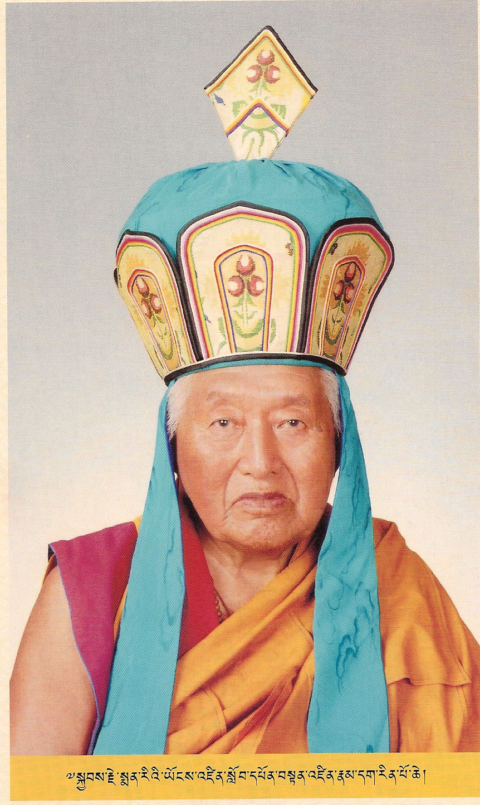
Lord of Refuge, His Eminence Menri Yongdzin Lopön Tenzin Namdak Rinpoché

Did you enjoy this content? This article is made possible by generous donors who want content like this to continue to be available.

Join the mandala of Nine Ways supporters by following this link: https://ravencypresswood.com/donate/

It’s easy through Paypal, Zelle, or Venmo. RCW108@gmail.com

Don’t want to miss a post? Scroll to the bottom and click “Follow this blog.”

---

## 3. The Lineage of the Three-fold Cycle of Dzogchen Proclamations

Source: <https://ravencypresswood.com/2015/04/04/the-field-of-accumulation-the-lineage-of-the-three-renowned-cycles-of-dzogchen/> · published 2015-04-04

Tsok zhing according to MenriThe Yungdrung Bon Merit Field of the Menri Tradition

In the Yungdrung Bön tradition, the place where the deities and objects of veneration are gathered is called the “Tsok Zhing”, the “Field of Accumulation”.  It is also sometimes translated as the “Field of Merit” or the “Merit Field” because what is being accumulated by paying homage and making offerings to this place is merit, or virtue.  This is the Merit Field according to the Menri Tradition from a drawing done by the great master and scholar HE Yongdzin Tenzin Namdak Rinpoche.

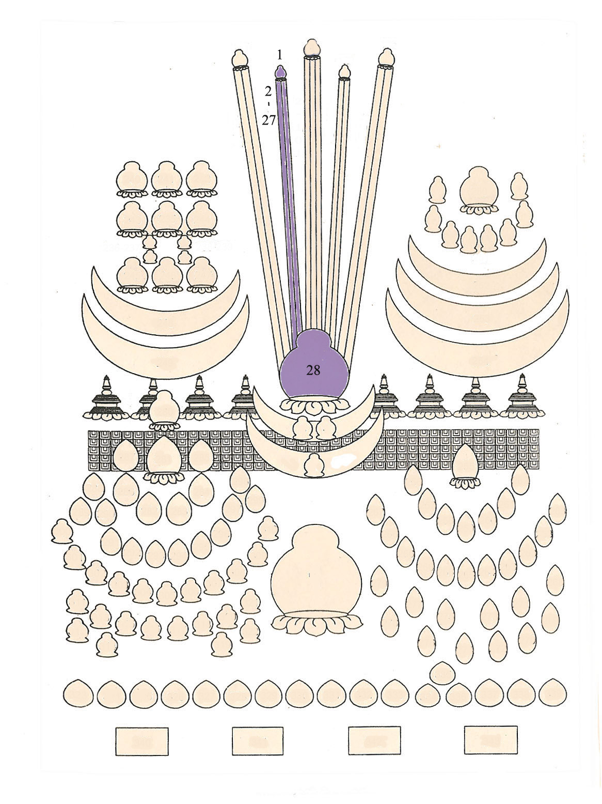
Diagram highlighting the placement of the Dzogchen Lineage within the Merit Field thangkha.

#1-28 depicts the Lineage of the Three-fold Cycle of Dzogchen Proclamations. In Tibetan, the Dzogchen Drakpa Korsum Gyü.

1. The source of the lineage, the White Light Deity, Shenlha Ökar.  He appears in the form of dzok ku, the enlightened Body of the Perfected Qualities and wears the corresponding ornaments.  His compassion is all-pervasive.

2. The Five Victorious Families who have gone beyond bliss, aka The Five Buddha Families.

3. Chimé Tsukphü.  He was the previous existence of the enlightened Lord Tönpa Shenrab Miwoche immediately before descending from heaven to earth.

4. Lhashen Yongsu Dakpa.  He was the shen of the gods who received the teachings from Chimé Tsukphü.

5. Milu Samlek.  He was the shen of the humans who received the teachings from Chime Tsukphü. He was born a prince in the ancient land of Tazik as his father, the king, was about to die.  He was known for his intelligence even as a young man.

#6-10  The Transmission of the Changeless Sages 

6. Lushen Yeshé Nyingpo.  He is the shen of the lu, aka nagas, who received the teachings from Chime Tsukphü.

7. Ödzer Pakmé.  He was a master from Tazik.

8. Münpo Künsal

9. Trulshen Nangden

10. Sangwa Düpa.  He was a chief disciple of Chimé Tsukphü. He was born a prince of Tazik.

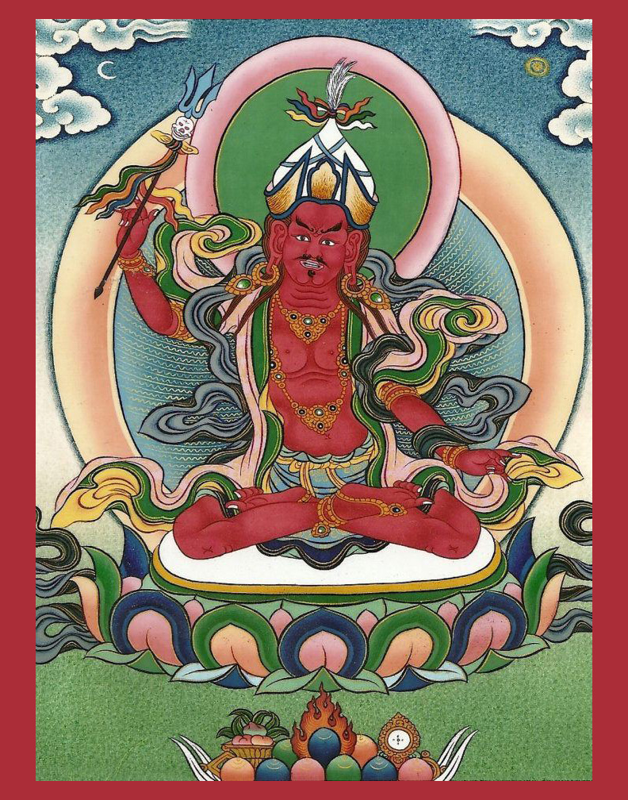
Translator and great yogi, Lama Tonggyung Tuchen

#11-14 The Transmission of the Scholarly Translators

11. Tonggyung Tüchen

12. Sé Bön Shari Uchen 

13. Chétsa Kharbu

14. Nyachen Lishu Taring.  A king and queen found a beautiful young girl in a forest. They named her Takza Liwer. Some time later, through the performance of ritual, she transformed herself into a man. However, she was still female when she wrote the root text for The Three-fold Cycle of Dzogchen Proclamations in the 8th century.  As a male, he became heir to the kingdom and was called Nyachen Lishu Taring.

15. Dé Bön Gyimtsa Machung  

16. Drupchen Chogye

17. Choza Bönmo

18. Zhotön Ngödrup Drakpa. He was an emanation of Lishu Taring and a tertön, or treasure revealer,  who rediscovered hidden texts behind a statue of Vairochana in Lhodrak that were hidden by Lishu Taring during a time of persecution for the Yungdrung Bön.

19. Gyaton Jodé

20. Zhikpo Nangseng

21. Kyotön Ngakpal

22. Yotön Lhunpal

23. Sengé Drukdra

24. Bönzhik Lodé

25. Tokden Yungrin

26. Khetsün Sherdrüp

27. Yonten Sengé

28. The Second Victor and founder of Tashi Menri Monastery, Nyammé Sherap Gyalsten 1356-1415.

---

## 4. The Lineage of the Profound Guidance through AH

Source: <https://ravencypresswood.com/2015/05/03/the-field-of-accumulation-the-lineage-of-the-profound-guidance-through-ah/> · published 2015-05-03

In the Yungdrung Bön tradition, the place where the deities and objects of veneration are gathered is called the “Tsok Zhing”, the “Field of Accumulation”.  It is also sometimes translated as the “Field of Merit” or the “Merit Field” because what is being accumulated by paying homage and making offerings to this place is merit, or virtue.  This is the Merit Field according to the Menri Tradition from a drawing done by the great master and scholar HE Yongdzin Tenzin Namdak Rinpoche.

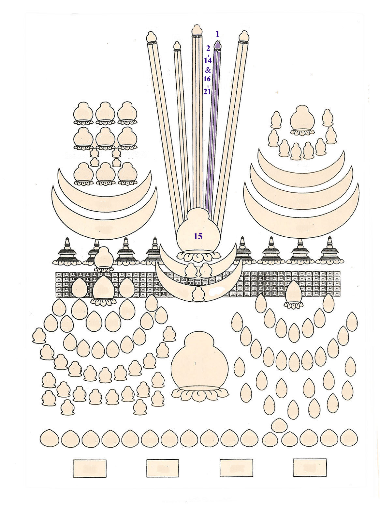

The Lineage of the Profound Guidance through AH, also known as the AH Tri, is one of three lineages of Dzogchen teachings in the Yungdrung Bön tradition.  (See previous posts regarding The Aural Transmission of Zhang Zhung and the Renowned Three Cycles of Dzogchen.) This lineage of Dzogchen teachings was closely associated with the Dru family.  From Menri Abbot Nyammé Sherap Gyaltsen until Menri Abbot Kunzang Gyaltsen, the lineage was passed down through the abbots of Menri Monastery.

1. Founder of the lineage, Me’u Gongdzö Ritropa.  He is often referred to simply as Dampa, “The Sage” or “The Saint”. (See previous post, The Saint.)  He exhibited many signs of accomplishment such as flying through the sky and leaving his hand and foot prints in stone. Although his primary focus was upon his meditation, he also wrote a number of texts.   In addition to material he collected from other sources, he added his own gong ter, or mind treasure, to this collection.  He organized the practice of the A Tri into 80 meditation sessions.

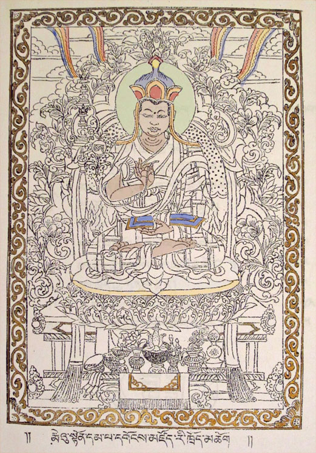
Founder of the AH Tri Lineage of Dzogchen teachings, The Saint, The Supreme Gongdzo Ritropa Rinpoche

2. Gomchen Barwa.  He was an unconventional person and became a great yogi.  He was known for odd and somewhat dramatic displays.  One day, Gongdzo Ritropa took Gomchen to a grassy area that was quite wet.  The lama knew that Gomchen was known to have been quite athletic in his youth.  So he told him to make a great leap. In doing so, Gomchen slipped and violently fell down.  In that very instant, he achieved spiritual realization without interruption.  Rather than taking ordination, he remained a laymen his entire life. He had many disciples and attained the rainbow body of light.

3. Kyunggom Joyung.

4. Dampa Tsulshé.

5. Drogön Yorpo Mepal.  He composed a commentary for the Guidance through AH teachings.

6.  Dutsi Gyaltsen.

7. A Zha Lodro Gyaltsen, 1198-1263.  He condensed the number of meditation sessions to 30.

8. Dru Dulwa Gyaltsen.  

9. Druchen Gyalwa Yungdrung, 1242-1290 A.D.  He was born into the Dru family in the area of Yeru Wensaka in Central Tibet.  He received his monk vows from his older brother, Dru Dulwa Rinpoche.  He was once the abbot of Yeru Wensaka Monastery which was founded by his family.  He further condensed the number of meditation sessions of the Guidance through AH to 15 and composed the fundamental practice text  “AH Tri Practice in 15 Sessions”.

10. Dru Namkha Odzer.  He was the younger brother of Dru Gyalwa Yungdrung.

11. Dru Sonam Gyaltsen, 1268-1321.  He was the nephew of Dru Gyalwa Yungdrung.

12. Dru Sonam Lodro, 1277-1341.

13. Dru Namgyal Kara

14. Rinchen Lodro.  His mother was from the Dru family.

15. Nyammé Sherap Gyaltsen, 1356-1415.  He is known as the Second Buddha and founded Tashi Menri Monastery in Tibet.  (See previous post, Celebration of the Second Buddha.)

16. Rinchen Gyaltsen.  He became abbot of Menri Monastery in 1415.

17. Namkha Yeshe.  He became abbot of Menri Monastery in 1446.

18. Kunzang Gyaltsen.  He became abbot of Menri Monastery in 1464.

19. Lodro Gyaltsen.

20. Tenpa Özer.

21. Nyima Özer.

---

## 5. The Lamas of Pure Discipline, The Monastic Lineage

Source: <https://ravencypresswood.com/2015/06/02/the-field-of-accumulation-the-lamas-of-pure-discipline-the-monastic-lineage/> · published 2015-06-02

In the Yungdrung Bön tradition, the place where the deities and objects of veneration are gathered is called the “Tsok Zhing”, the “Field of Accumulation”.  It is also sometimes translated as the “Field of Merit” or the “Merit Field” because what is being accumulated by paying homage and making offerings to this place is merit, or virtue.  This is the Merit Field according to the Menri Tradition from a drawing done by the great master and scholar HE Yongdzin Tenzin Namdak Rinpoche.

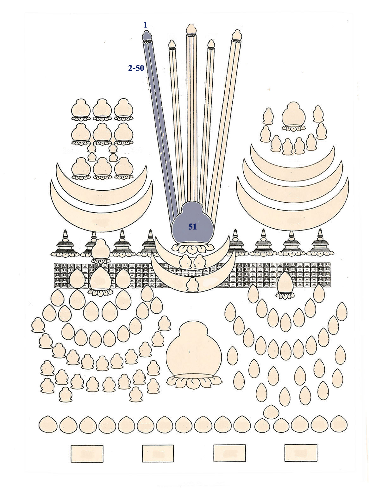

This is the lineage of monastic discipline.  These lineage masters have all taken monk’s vows and therefore wear the appropriate clothing to distinguish them from laypeople.

1. Tritsuk Gyalwa. 16,017 BC – 7,817 BC.  This is the name that the enlightened Lord Tönpa Shenrap Miwoche received upon taking ordination as a monk at the age of 31.  Although he was already a completely enlightened being, he showed the example of taking the path of renunciation.

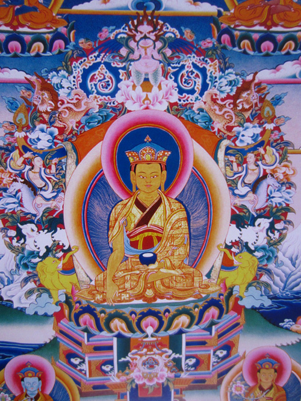
Lord Tonpa Shenrap showing the path of renunciation as the monk Tritsuk Gyalwa

2. Tsukshen Gyalwa

3. Drangsong Gyalwa.  He was one of Tönpa Shenrap’s eight sons.  His birth name was Tobu Bumsang.

4. Tsukse Mawo

5. Tridé Gungdrak

6. Mucho Demdruk

7. Mutsa Trahé.  He was from the ancient land of Tazik.  He was one of The Six Translators who wrote down the words of Lord Tönpa Shenrap into their respective languages and brought them to their respective countries.

8. Tridé Öpo

9. Lhang Lhang Tsukphü

10. Dangwa Yi Ring 

11. Thukar Yeshé

12. Gung Rum Yeshe

13. Ölha Selbar

14. Dzütrul Yeshé

15. Yeshé Tsultrim

16. Yungdrung Tsultrim

17. Tsukphü Tsultrim

18. Gachu Gyalwa

19. Yagong Gyalwa

20. Détsun Rabsel

21. Jotsün Yeshé

22. Muzi Salzang.  He was a manifestation of Mucho Demdruk.  During a time of suppression, he retreated to a cave and went into a meditation of cessation, stopping all thoughts and sensations.  Hundreds of years later, Tribar Tsultrim came upon him in the cave.

23. Tribar Tsultrim.  He was the manifestation of Tsukshen Gyalwa.  He was born a prince but due to external circumstances, he was banished to Mongolia and became a slave of a local ruler.  One day, while looking after the ruler’s horses, he wandered into a cave that looked dark at the entrance but light on the inside.  Once inside the cave, he saw a figure that resembled a monk but whose hair had grown down to the ground and become entangled.  The karmic connection immediately ripened and he joyfully began prostrating and requesting that the monk awake from his meditation.  Day after day, he returned to the cave.  First, one of the monk’s eyebrows moved, then a portion of his face.  On the third day, he yelled at the slave, “Are you a human or non-human obstacle?”  The slave replied that he desired to become his disciple.  The monk agreed and gave him full ordination.  The monk in the cave was Muzi Selzang.

24. Gyalwa Tsukphü.  He was the manifestation of Tobu Bumsang, son of Lord Tönpa Shenrap.

25. Tsukphü Tsultrim.  He was the manifestation of Tsukse Mawo.

26. Lachen Mutur. He was born in 952 AD.  He was also known by his monastic name, Sherap Tsultrim.  He had many disciples, both Yungdrung Bön and Buddhist.  He gave his disciples the four signs of monastic ordination which were, Upper and lower garments, a lotus hat and a meditation mat that were all blue.  He said that if the articles could not be entirely blue, then they should have parallel seams of blue thread.  He was a manifestation of Mutsa Trahé.

27. Nyö Tsün Rinchen Gyaltsen.  He was the manifestation of Tridé Öpo.

28. Nyö Künga Tsultrim.  He was the manifestation of Lhang Lhang Tsukpü.

29. Gar Rinchen Tsukpü.  He was the manifestation of Dangwa Yi Ring

30. Trapü Tsultrim.  He was the manifestation of Tuk Kar Yeshé.

31. Nyöla Drukpa Tsultrim Yeshé.  He was the manifestation of Gang Rum Tsukpü.

32. Sheltsün Yungdrung.  He was the manifestation of Ölha Salwar.

33. Gur Tsün Yungdrung Gyaltsen.  He was the manifestation of Yeshé Tsultrim.

34. Khenlop Namnyi

35. Me’u Gongdzö Ritropa. 1038-1096.  He was the manifestation of Sertok Chejam and founder of the AH Tri Lineage of Dzogchen teachings.  (See previous post, The Saint.)

 After these lamas, the lineage splits into four different lines according to the families of Dru, Zhu, Pa and Shen. The following is the lineage of the 1st Abbot of Menri Monastery, Nyammé Sherap Gyaltsen.

 36. Métön Sherab Ödzer

37. Shentön Namkha Gyaltsen.  He was the manifestation of the great lama, Drenpa Namkha.

38. Yorpo Métön Drakpa Pal.  He was a manifestation of the great lama, Drenpa Namkha.

39. Dütsi Gyaltsen.  He was the manifestation of Lhatri of Zhang Zhung.

40. Darma Gyaltsen.  He was the manifestation of Hripa Gyermé.

41. Tsultrim Lama

42. Drogön Martön Gyallé

43. Bartang Zhangtön Sonam

44. Sumtön Lhabum

45. Shentön Drogön Lodro Gyaltsen

46. Shentön Yeshé Lodro.  In 1173, he built the temple of Darding Sergo Tramo Tsukla Khang in Darding.

47. Men Gongwa Dülwa Lodro

48. Men Gongwa Sherap Lodro

49. Gya Rongwa Yungdrung Yeshé

50. Drutön Tsultrim Yeshé.  He was the Abbot who gave vows to Nyammé Sherap Gyaltsen.

51. Nyammé Sherap Gyaltsen. 1356-1415.  He is known as the Second Buddha and was the founder and 1st abbot of Tashi Menri Monastery in Tibet.  (See previous post, Celebration of the Second Buddha.)

---

## 6. Lamas of the Renowned Three Cycles of Secret Mantra

Source: <https://ravencypresswood.com/2015/08/15/the-field-of-accumulation-lamas-of-the-renowned-three-cycles-of-secret-mantra/> · published 2015-08-15

In the Yungdrung Bön tradition, the place where the deities and objects of veneration are gathered is called the “Tsok Zhing”, the “Field of Accumulation”.  It is also sometimes translated as the “Field of Merit” or the “Merit Field” because what is being accumulated by paying homage and making offerings to this place is merit, or virtue.  This is the Merit Field according to the Menri Tradition from a drawing done by the great master and scholar His Eminence Yongdzin Tenzin Namdak Rinpoche.

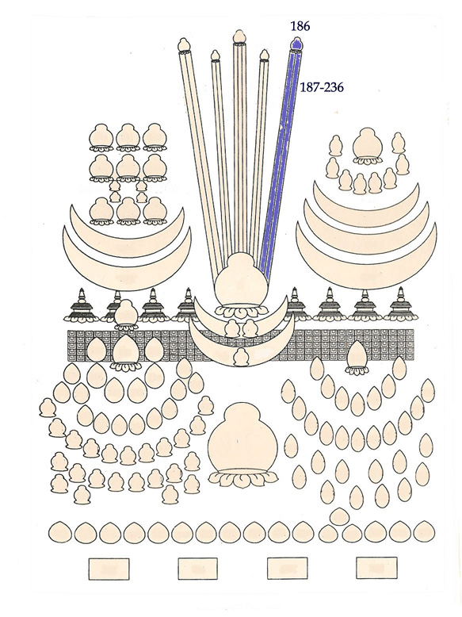

This is the lineage of tantra and these lineage masters wear the clothes of yogis, tertons or revealers of hidden sacred treasure, or monks accordingly.  These profoundly pure masters of tantra have all accomplished the attainments of practice.

1. Trulshen Nangden was the incarnation of Lord Tönpa Shenrap before he manifested in Olmo Lungrik.  Transforming himself into a blue cuckoo, he alighted upon the shoulder of the deity Zangza Ringtsun.  This caused a subtle, internal heat.  As a result, he was miraculously born to her as Chimé Tsukpü.

2. Zangza Ringtsun was an emanation of the enlightened wise, loving Mother, Sherap Chamma who received the teachings of the Secret Mother Tantra from the primordial Buddha.

3. Chimé Tsukpü was miraculously born to Zangza Ringtsun.

4. Sangwa Düpa is cited in some texts as the previous incarnation of Buddha Shakyamuni.

5. Takla Mebar was a prince of Tazik.

6. Lhashen Yongsu Dakpa spread the teachings among the gods.

7. Milu Samlek was known for his intelligence and wrote separate commentaries for each of the three cycles of the Mother Tantra: outer, inner, and secret.  He spread the teachings in the human realm.

8. Ludrup Yeshe Nyingpo was born to parents who had been childless for a long time.  After making offerings and praying to the lu, or naga, a child was born to them.  He spead the teachings among the lu.

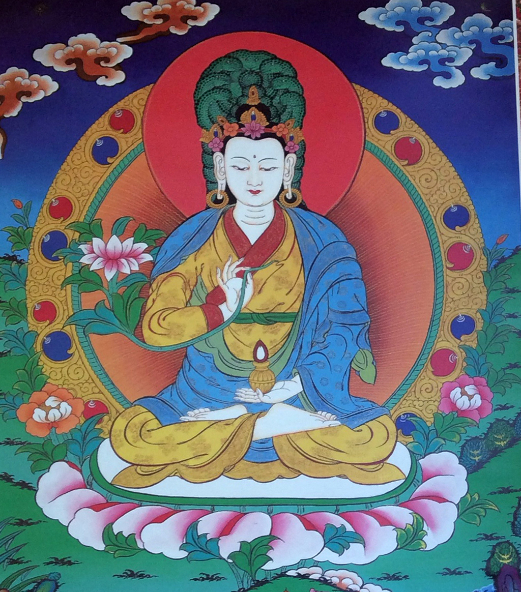
Lama Ludrup Yeshe Nyingpo

9. Nangwa Dokchen transmitted the teachings to the son of the first Tibetan king.

10. Mutri Tsenpo was the son of the first Tibetan king, Nyatri Tsenpo.  He invited one hundred eight esteemed scholars of Zhang Zhung to Tibet.  After him, these teachings were not taught for three generations due to political obstacles.

11. Hara Chipar received the teachings from the four magical khandro of the elements of earth, fire, water and air in order to keep the teachings from further decline.

12. Takwer Liwer was a female practitioner and achieved supernatural powers.  She could tame wild animals and also transform herself into anything that she wished.  The spirits of earth and water obeyed her commands.  After living for three hundred sixty years, she achieved the fruit of realization, the rainbow body of light.

13. Anu Traktak practiced on Mount Tise (Kailash) and lived for two hundred fifty-five years.

14. Sené Ga’u was born in Zhang Zhung and had many teachers.  It is said that he could cure leprosy simply by looking at the patient.  He achieved the rainbow body of light.

15. Tami Teké lived for two hundred seventy-seven years and achieved supernatural powers.

16. Shebu Rakhuk lived for two hundred years and achieved supernatural powers.

17. Zingwa Tüchen was a Chinese practitioner and lived for two hundred sixty-one years.

18. Pébön Toktsé

19. Pébön Toktrul lived for one hundred thirty-five years.

The Four Great Scholars: 20-23 These four scholars translated many Yungdrung Bön texts from the Zhang Zhung language into Tibetan.

20. Tonggyung Tüchen

21. Shari Uchen was a previous manifestation of the modern day saint, Shardza Tashi Gyaltsen Rinpoche.

22. Gyimte Machung

23. Chetsa Kharbu

24. Hripa Gyermé

25. Mutsa Gyermé gave the text Zi Ji to the 14th century master, Loden Nyingpo in a vision.

26. Drenpa Namkha was born in 753 AD.  In general, there are three Drenpa Namkha that are incarnations of the previous one.  1) Drenpa Namkha of Tazik 2)Drenpa Namkha of Zhang Zhung who was a prince and is commonly referred to as La Chen, the great lama.  It was this Drenpa Namkha that married an Indian Brahman girl and had twin sons, Tsewang Rikdzin and Pema Tongdrol.  3) Drenpa Namkha of Tibet who saved many Yungdrung Bön texts from destruction during the persecution of Bön by the Tibetan kind Trisong Detsen.  See previous post, “Practice of the Great Lama, Drenpa Namkha.”

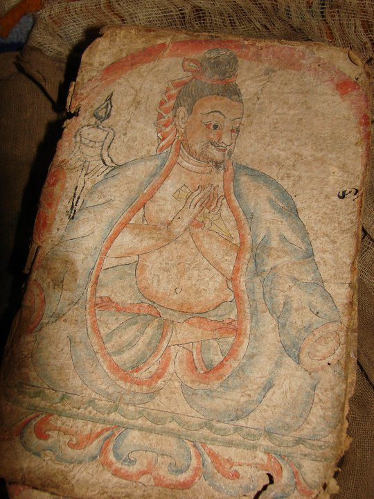
Lama Drenpa Namkha

27. Shenchen Luga 996-1035 was a manifestation of Tonggyung Tüchen and was a terton, or treasure discoverer, one who discovers texts and/or sacred objects that are hidden. He had many disciples who began religious centers in their respective home villages.

28. Germi Nyi Öd was born in Zhang Zhung and was a terton.  He lived for three hundred years.

29. Matön Sidzin was a terton who discovered many texts including a ritual invocation of the protector Sipe Gyalmo.

30. Yiltön Khyungö Tsal was born in 1198 and was a great terton who discovered many texts including the main ritual text for the protector and yidam Gekho,

31. Druchen Namkha Yungdrung

32. Wangden Zhuye Lekpo was one of Shenchen Luga’s main disciples and served him as an attendant. He founded the famous Ri Zhing Monastery.

33. Patön Palchok Zangpo was one of the final disciples to meet Shenchen Luga.

34. Me’u Lhari Nyenpo composed a summary of the long version of the Yungdrung Bön Prajnaparamita that was discovered as terma by Shenchen Luga.

35. Drusha Khyungi Gyaltsen was the son of Druchen Namkha Yungdrung.

36. Drusha Jetsun

37. Drutön Nyigyal

38. Yorpo Mépal 1134-1168

39. Nyi Tsultrim Gyaltsen

40. Drogön Dutsi Gyaltsen

41. Drogön Lodro Gyaltsen 1198-1263 was also known as Azha Lodro Gyaltsen.

42. Dulwa Gyaltsen

43. Drutön Gyalwa Yungdrung

44. Namkha Özer

45. Sonam Gyaltsen

46. Sonam Lodro

47. Namkha Sonam

48. Tsewang Gyaltsen

49. Namkha Rinchen

50. Namgyal Kara

51. Khedrup Rinchen Lodro

---

## 7. The Gathering of Buddhas

Source: <https://ravencypresswood.com/2016/04/07/the-field-of-accumulation-the-gathering-of-buddhas/> · published 2016-04-07 · master numbers 235–249

In the Yungdrung Bön tradition, the place where the deities and objects of veneration are gathered is called the “Tsok Zhing”, the “Field of Accumulation”.  It is also sometimes translated as the “Field of Merit” or the “Merit Field” because what is being accumulated by paying homage and making offerings to this place is merit, or virtue.  This is the Merit Field according to the Menri Tradition from a drawing done by the great master and scholar His Eminence Yongdzin Tenzin Namdak Rinpoche.

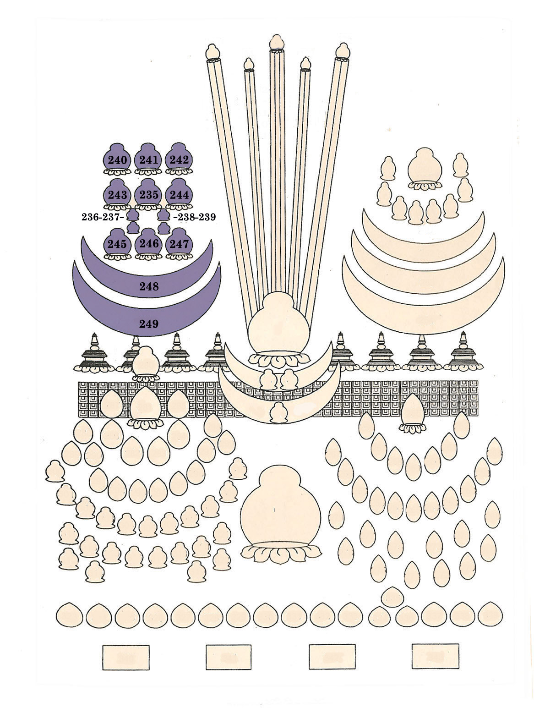

This is the gathering of all of the Enlightened Beings.

235. Gyalwa Shenrap Miwo Künlé Nampar Gyalwa, the Completely Victorious in Every Way, Shenrap Miwo.  16,017 BC – 7,817 BC.  He is the Enlightened Being of the present time and founder of the Yungdrung Bön religious tradition.  He appeared in the human realm when the human life-span was generally 100 years long.  There are three versions of his life history: short, medium and long.  The short version is within a text commonly referred to as the Do Dü.  It is a terma, or rediscovered text, and has twenty-four chapters within one volume.  The medium length version is within a text commonly referred to as the Zer Mik.  It is also a terma and has eighteen chapters in two volumes.  The long version is within a text commonly referred to as the Zi Ji.  It is part of a group of orally transmitted texts and has sixty-one chapters in twelve volumes.

236. Yungdrung Tsukshen Gyalwa.

237. Sebu Malo.  One of the main disciples of Shenrap Miwo.

238. Sebu Yulo. One of the main disciples of Shenrap Miwo.

239. Tobu Bumsang.  He was the eldest son of Tönpa Shenrap Miwo.  He led a group of disciples who primarily practiced the dzogchen teachings.

#240-246 Enlightened Beings that Appeared in Past Eons

240. Nangwa Rangjung Tukjéchen.  This Enlightened Being appeared in the world when the human life-span was generally 100,000 years long.

241. Gewa Khorwa Kündren.  This Enlightened Being appeared in the world when the human life-span was generally 80,000 years long.

242. Künshé Nyonmong Duksek. This Enlightened Being appeared in the world when the human life-span was generally 60,000 years long.

243. Lékpa Tsemé Tukjéchen. This Enlightened Being appeared in the world when the human life-span was generally 40,000 years long.

244. Nyompa Tamche Khyenzik. This Enlightened Being appeared in the world when the human life-span was generally 20,000 years long.

245. Jampa Trigyal Khukpa. This Enlightened Being appeared in the world when the human life-span was generally 10,000 years long.

246. Dakpa Togyal Yékhyen.This Enlightened Being appeared in the world when the human life-span was generally 1,000 years long.  He was the eldest brother of Tönpa Shenrap Miwo in the celestial realm.

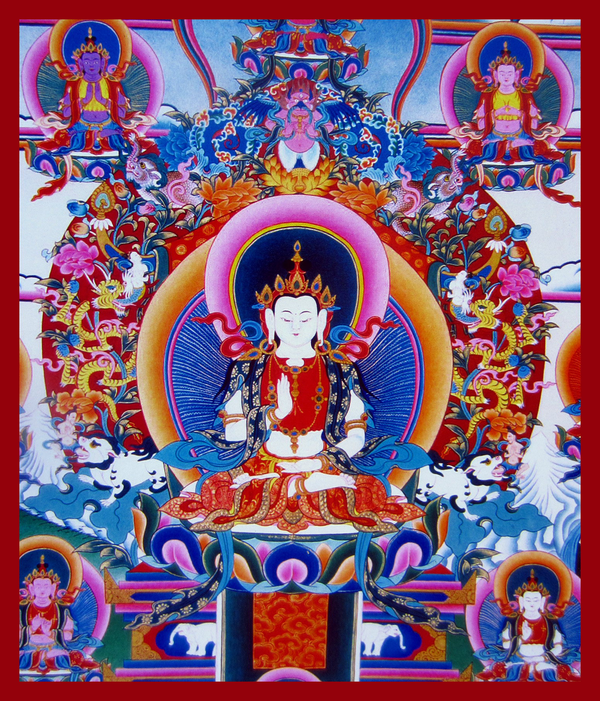
Jamden Rangma Medron, the Buddha prophesized to appear in the future

247. Jamden Rangma Médron.  This Enlightened Being is prophesized to be the Buddha of the Future and will appear in this world when the human life-span has declined to be only 10 years long.  He was the younger brother of Tönpa Shenrap Miwo in the celestial realm.  He is depicted upon a throne held aloft by elephants and seated upon cushions of a sun, moon, and lotus.  His right hand is held in a mudra of contemplation at the center of his heart and his left hand is held in the mudra of equipoise.  His body is the color of clear crystal and upon his head is a crown of precious jewels.

248. The 1002 enlightened Beings of the Fortunate Eon.

249. All of the Enlightened Beings found throughout the ten directions.

---

## 8. The Yungdrung Sempa

Source: <https://ravencypresswood.com/2016/09/04/the-field-of-accumulation-the-yungdrung-sempa/> · published 2016-09-04

The Field of Accumulation according to the Menri Tradition

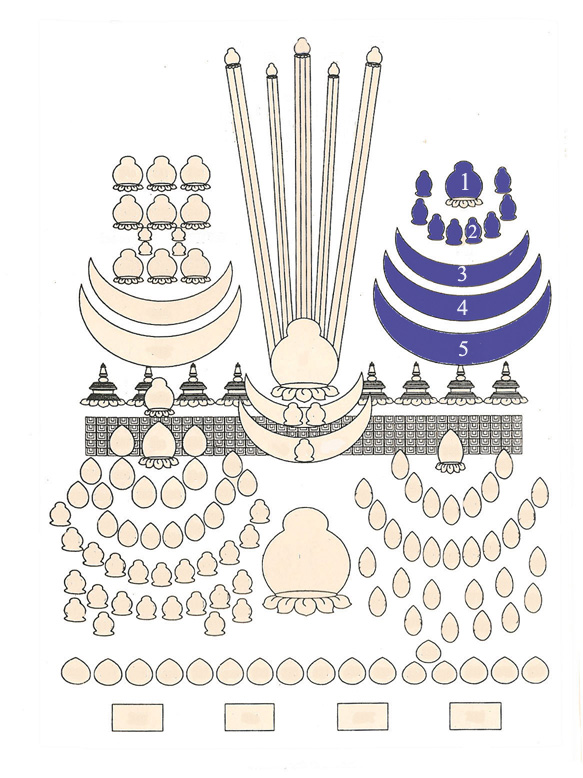
Yungdrung Sempa, Changeless & Ceaseless Warriors of the Mind

The term ‘Bodhisattva’ is a commonly used Sanskrit word referring to a practitioner who has fully developed their compassion as well as their intention to attain enlightenment in order to benefit other beings as well as themselves.  In the Yungdrung Bön, the term is jang chub sempa.  This literally translates as a ‘warrior or hero of the mind who has attained purification and understanding.’  There are many levels of jang chub sempa.  Depicted in the Field of Accumulation in the Menri tradition are the Yungdrung Sempa, the Changeless and Ceaseless Warriors of the Mind.  Among this group of Yungdrung Sempa, there are the Great Yungdrung Sempa and the Unsurpassed Yungdrung Sempa.  The Great Yungdrung Sempa are the warriors of the mind who have reached one of the first seven grounds which are still considered impure.  The Unsurpassed Yungdrung Sempa have reached one of the final three grounds which are considered pure.

A Yungdrung Sempa can manifest as any kind of sentient being in order to be of benefit.

- Dung Tsop Mucho Démdruk: He is the Speech manifestation of the Enlightened Lord Tönpa Shenrap.  In the Wood Dragon year of 6016 B.C., he descended from Ölmo Lungrik to the earth in order to benefit sentient beings.  This was 1,801 years after Lord Tönpa Shenrap showed the appearance of passing into parinirvana.  During this time, many scholars appeared.  In the Water Rabbit year of 5717 B.C., he went to the realm of the demi-gods in order to give teachings.

- Yungdrung Sempa of the Ten Stages of the Path of Meditation

- Yungdrung Sempa of the Path of Seeing

- Yungdrung Sempa of the Path of Preparation

- Yungdrung Sempa of the Path of Accumulation

Raven Cypress Wood© All Rights Reserved

---

## 9. The Ocean of Khandro

Source: <https://ravencypresswood.com/2016/11/13/the-field-of-accumulation-the-ocean-of-khandro/> · published 2016-11-13

Tsok zhing according to MenriThe Yungdrung Bon Merit Field of the Menri Tradition

In the Yungdrung Bön tradition, the place where the deities and objects of veneration are gathered is called the “Tsok Zhing”, the “Field of Accumulation”.  It is also sometimes translated as the “Field of Merit” or the “Merit Field” because what is being accumulated by paying homage and making offerings to this place is merit, or virtue.  This is the Merit Field according to the Menri Tradition from a drawing done by the great master and scholar HE Yongdzin Tenzin Namdak Rinpoche.

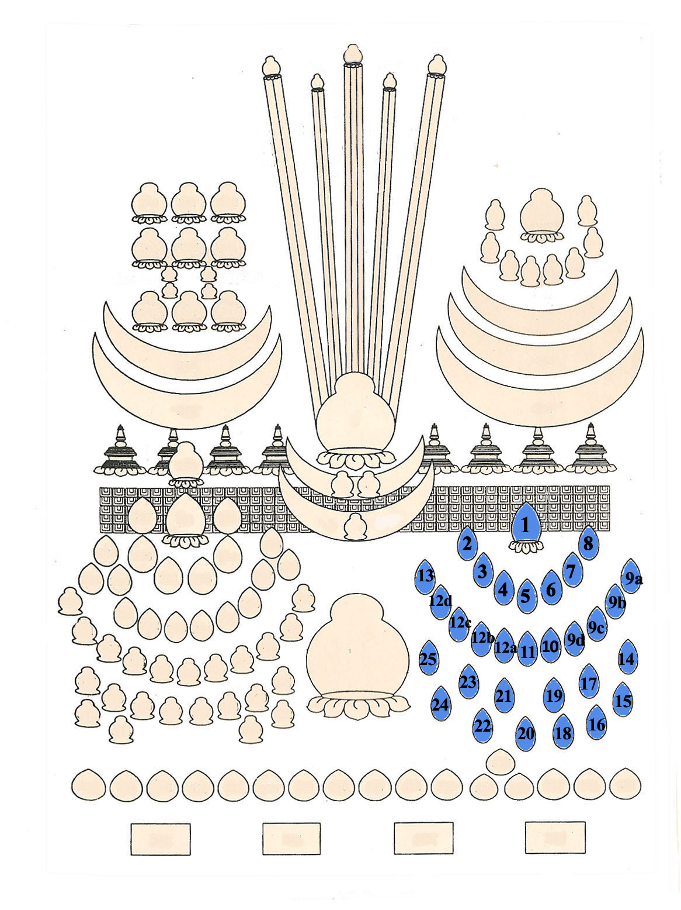

The Ocean of Khandro are depicted as figures #1-25.   Khandro (Sanskrit: dakini) literally translates as ‘sky-goer’ or ‘one who moves in the sky’.  Khandro are a class of female beings who protect and serve the religious tradition as well as bestow spiritual attainments.   Khandro can be classified in many ways.  The classification below is according to the Tsok Zhing text.  Each of the khandro are adorned with the six bone ornaments.

#1-8 Wisdom Khandro

1. Kalpa Zangmo,  she has one face and four arms

2. Miyo Tenma

3. Dekma Kündrol

4. Kyema Ötso, Khandro of the Mother Tantra

5. Namkha Déden

6. Dakpa Kündü

7. Salwa Dröbéb

8. Tukjé Kündrol, Khandro of Tummo and Tsa Lung

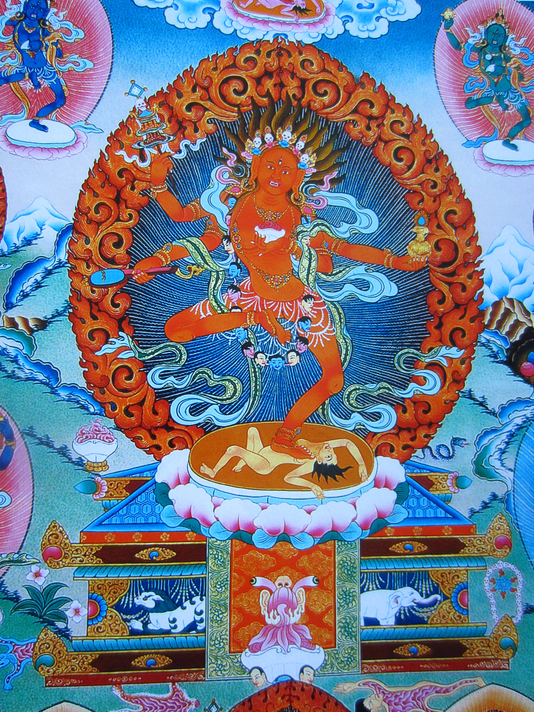
Khandro Kalpo Zangmo

#9-13 Action Khandro

9a. Ürgyen Khandro, Khandro from Ürgyen

9b. Ürgyen Khandro, Khandro from Ürgyen

9c. Ürgyen Khandro, Khandro from Ürgyen

9d. Ürgyen Khandro, Khandro from Ürgyen

10. Choza Bönmo, Khandro of the female lineage of the Yétri Tasel Dzogchen

11. Öden Barma, Consort of Yidam Drenpa Namkha

12a. Gyagar Khandro, Khandro from India

12b. Gyagar Khandro, Khandro from India

12c. Gyagar Khandro, Khandro from India

12d. Gyagar Khandro, Khandro from India

13. Drushé Khandro, Khandro from Drusha

#14-25 Animal-headed Khandro

14. Durjé Ü, Heron-headed Khandro

15. Pharwé Ü, Coyote-headed Khandro

16. Chusin Ü, Crocodile-headed Khandro

17. Duktrul Ü, Poisonous Snake-headed Khandro

18. Chè Chang Ü, Jackal-headed Khandro

19. Sengé Ü, Lion-headed Khandro

20. Khyungi Ü, Garuda-headed Khandro

21. Takgi Ü, Tiger-headed Khandro

22. Zikgi Ü, Leopard-headed Khandro

23. Domgi Ü, Bear-headed Khandro

24. Drékyi Ü, Yellow Bear-headed Khandro

25. Khaté Ü, Crow-headed Khandro

Raven Cypress Wood ©2015

---

## 10. The Yidams

Source: <https://ravencypresswood.com/2017/08/20/the-field-of-accumulation-the-yidams/> · published 2017-08-20

Tsok zhing according to MenriThe Yungdrung Bon Merit Field of the Menri Tradition

In the Yungdrung Bön tradition, the place where the deities and objects of veneration are gathered is called the “Tsok Zhing”, the “Field of Accumulation”.  It is also sometimes translated as the “Field of Merit” or the “Merit Field” because what is being accumulated by paying homage and making offerings to this place is merit, or virtue.  This is the Merit Field according to the Menri Tradition from a drawing done by the great master and scholar HE Yongdzin Tenzin Namdak Rinpoche.

Yidams are deities who have their own individual cycles of practice with the aim of acquiring the qualities and blessings of the yidam being meditated upon.  In general, these cycles of practice are centered around an individual retreat in which the practitioner focuses upon self-transformation into the deity, recitation of the deity’s mantra, along with any other ritual or meditation specific to the deity which support the attainment of the deities qualities and blessings.  There are yidams specific to a family lineage, to monastic lineages as well as personal yidams.  Some of the vows associated with yidam practice are general to all, and some vows are specific to each yidam.  Some yidams are represented more than once to signify their different tantric cycles.

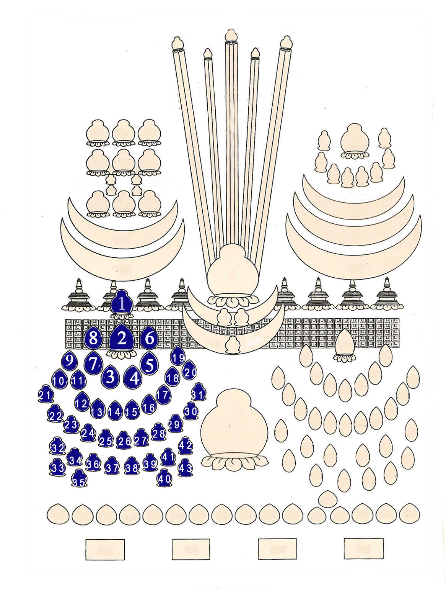

#2-4, 14 & 18: The Five Supreme Embodiments of the Father Tantra (See previous post:https://ravencypresswood.com/2016/06/05/the-five-supreme-embodiments/)

1. Zhiwa Künnang Khyappa: This yidam represents all peaceful yidams

2. Trowo Tsochok Khagying: This yidam is an embodiment of the Enlightened Mind of Buddha Tönpa Shenrap Miwoche.

3. Walsé Ngampa: This yidam is an embodiment of the Enlightened Body of Buddha Tönpa Shenrap Miwoche.

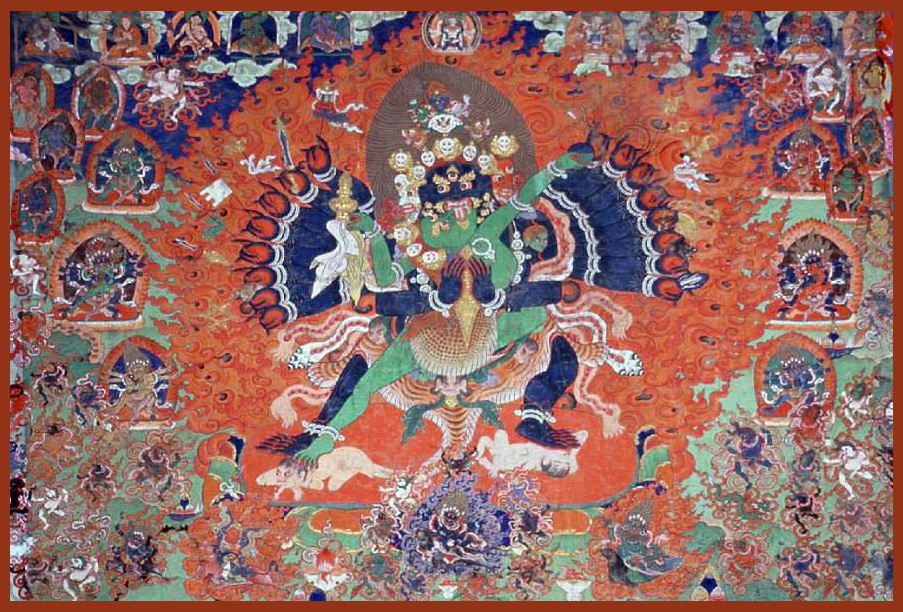
The Yidam Walse Ngampa, Embodiment of the Enl ightened Body

4. Lhago Tokpa: This yidam is an embodiment of the Enlightened Speech of Buddha Tönpa Shenrap Miwoche.

5. Sangwa Ying Rol

6. Tséwang Rikdzin: As a long life deity, this yidam is white in color.

7. Magyü Sangchok Tartuk: This yidam is the principal deity of the Mother Tantra and is also known as Tukjé Galpo.

8. Drenpa Namkha

9. Bumpa

10. Rampa

11. Rolpa

12. Dütsi Yungdrung Khyilwa

13. Takla Pudri Marpo

14. Gekho Sangwa Drakchen:  This yidam is the embodiment of the Enlightened Qualities of Buddha Tönpa Shenrap Miwoche.

15. Trowo Druksé Chempa: This yidam is the Embodiment of the Enlightened Activities of Buddha Tönpa Shenrap Miwoche.

16. Meri Walchen Gekho

17. Chidul Yidam Gyatso Trogyal Raksha Khagying

18. Sangpur

19. Walsé Khyungnak Trowo Karpo

20.Wal Khyung Marpo

Yidams of the Other Tantras

#22-#25 The Four Principal Enlightened Ones (See previous post https://ravencypresswood.com/2016/08/20/the-four-principal-enlightened-ones/)

21. Gyepa Kunnang Khyapa

22. Tönpa Shenrap Miwo

23. Sipa Sangpo Bumtri

24. Lhachen Shenlha Ökar

25. Yumchen Satrik Érsang

26. Shenrap Nampar Gyalwa

27. Namdak

28. Jamma

29. Mélha

30. Kéngtsé Lenmé

31. Sherab Mawé Séngé

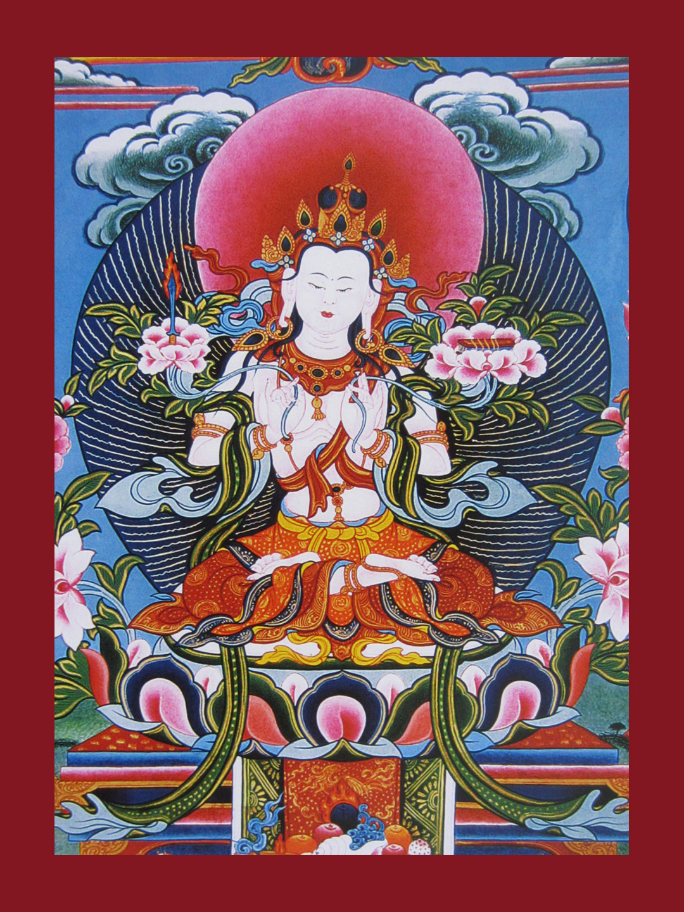
The Yidam Mawe Senge

32. Dülchok Tönpa Tritsuk Gyalwa

33. Jamma

34. Namdak

35. Mönlam Taye

36. Menlha

37. Künying

38. Gényen Tékpa Lha

39. Jamden

40. Dükhor

41. Künrik

42. Gyalwa Gyatso

43. Namjom

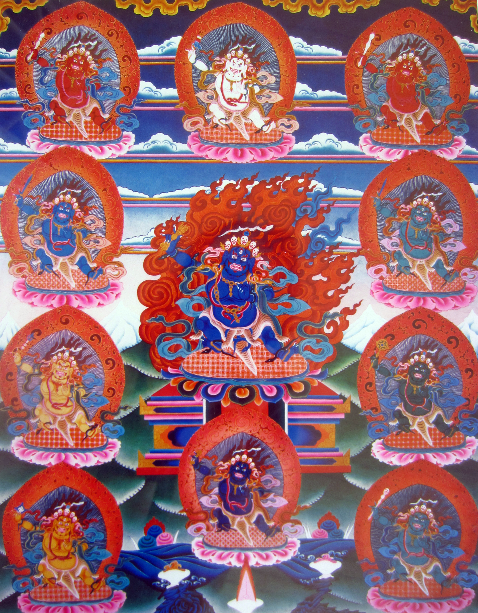
The Yidam Namjom, aka Nampar Jompa, and his emanations.
