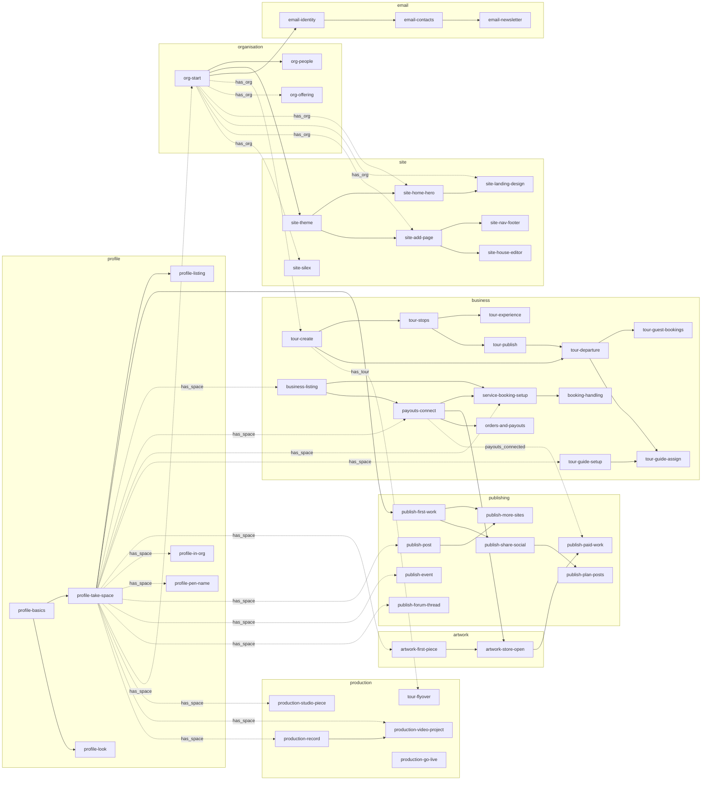

# Rails nexus

Generated by `scripts/check-rails.mts` from `atlas/tracks/` and the atlas. Do not edit; regenerate with `pnpm --filter @elkdonis/actions check:rails`.

47 tracks, 116 steps, 19 gates (9 resolve, 10 todo), 21 candidate courses, 10 gaps. All tracks are `candidate`.

## Graph

Solid arrows: `leads_to`. Dotted arrows: a gate the later track requires, labelled with the gate.

## Tracks

| track | area | steps | requires | provides | leads to |
|---|---|--:|---|---|---|
| business-listing | business | 4 | has_space | has_business_page | service-booking-setup, payouts-connect |
| payouts-connect | business | 2 | has_space | payouts_connected | service-booking-setup, artwork-store-open, orders-and-payouts |
| service-booking-setup | business | 5 | has_space | has_service | booking-handling |
| booking-handling | business | 3 | has_service | - | - |
| orders-and-payouts | business | 2 | payouts_connected | - | - |
| tour-guide-setup | business | 2 | has_space | has_guide_profile | tour-guide-assign |
| tour-guide-assign | business | 2 | has_guide_profile, has_tour_slot | - | - |
| tour-create | business | 2 | has_org | has_tour | tour-stops, tour-departure |
| tour-stops | business | 5 | has_tour | has_tour_stops | tour-experience, tour-publish |
| tour-experience | business | 3 | has_tour_stops | - | - |
| tour-publish | business | 2 | has_tour_stops | - | tour-departure |
| tour-departure | business | 3 | has_tour | has_tour_slot | tour-guest-bookings, tour-guide-assign |
| tour-guest-bookings | business | 3 | has_tour_slot | - | - |
| tour-flyover | production | 1 | has_tour | - | - |
| artwork-first-piece | artwork | 2 | has_space | has_artwork | artwork-store-open |
| artwork-store-open | artwork | 1 | payouts_connected | has_store | publish-paid-work |
| profile-basics | profile | 2 | - | has_profile_photo | profile-take-space, profile-look |
| profile-take-space | profile | 2 | has_profile_photo | has_space | profile-listing, publish-first-work |
| profile-listing | profile | 2 | has_space | - | - |
| profile-look | profile | 1 | - | - | - |
| profile-in-org | profile | 1 | has_space | - | - |
| profile-pen-name | profile | 3 | has_space | - | - |
| publish-post | publishing | 2 | has_space | - | publish-more-sites |
| publish-first-work | publishing | 2 | has_space | has_published_work | publish-more-sites, publish-share-social |
| publish-more-sites | publishing | 2 | has_published_work | - | - |
| publish-share-social | publishing | 3 | has_published_work | has_connected_social | publish-plan-posts |
| publish-plan-posts | publishing | 3 | has_connected_social | - | - |
| publish-paid-work | publishing | 2 | payouts_connected, has_store | - | - |
| publish-event | publishing | 2 | has_space | - | - |
| publish-forum-thread | publishing | 2 | has_space | - | - |
| org-start | organisation | 2 | has_space | has_org | org-people, site-theme, email-identity |
| org-people | organisation | 3 | has_org | - | - |
| org-offering | organisation | 2 | has_org | - | - |
| site-theme | site | 2 | has_org | - | site-home-hero, site-add-page |
| site-home-hero | site | 4 | has_org | - | site-landing-design |
| site-landing-design | site | 2 | has_org | - | - |
| site-add-page | site | 3 | has_org | has_site_page | site-nav-footer, site-house-editor |
| site-nav-footer | site | 2 | has_site_page | - | - |
| site-house-editor | site | 2 | has_site_page | - | - |
| site-silex | site | 3 | has_org | - | - |
| production-studio-piece | production | 4 | has_space | - | - |
| production-video-project | production | 5 | has_space | has_video_project | - |
| production-record | production | 3 | has_space | - | production-video-project |
| production-go-live | production | 3 | is_org_member | - | - |
| email-identity | email | 1 | has_org | has_email_identity | email-contacts |
| email-contacts | email | 2 | has_email_identity | has_email_contacts | email-newsletter |
| email-newsletter | email | 2 | has_email_contacts | - | - |

## Gates

| gate | resolver | label |
|---|---|---|
| has_profile_photo | gates:hasProfilePhoto | The person has a profile photo |
| payouts_connected | gates:payoutsConnected | Payouts are set up with Stripe |
| is_org_member(org) | gates:isOrgMember | The person has a role in the organisation |
| has_published_work | gates:hasPublishedWork | The person has published a piece of writing or an artwork |
| has_service | gates:hasService | The person has offered a service |
| has_space | services:hasGainedSpace | The person has taken their space (folder and directory place) |
| has_org | status:org | The person owns an organisation |
| has_store | status:store | The person has an open store on the market |
| has_artwork | status:artwork | The person has an artwork listed |
| has_connected_social | todo | A social account is connected |
| has_business_page | todo | The business has a page or listing |
| has_guide_profile | todo | The guide has an elktours artist profile |
| has_tour | todo | The org has a saved tour (elktours) |
| has_tour_stops | todo | A tour has stops with media |
| has_tour_slot | todo | A tour has a dated departure |
| has_site_page | todo | The org site has a page of its own |
| has_email_identity | todo | The org has a sending name and reply address |
| has_email_contacts | todo | The org has a mailing list with contacts |
| has_video_project | todo | The person has a video project |

## Candidate courses (paths)

Course, then its ordered tracks and their steps. `[gap]` marks a step with no capability yet. `builds_on` is checked against the gates the tracks require.

### profile-setup (profile)

Set up a profile. Builds on: nothing. Derived from gates: nothing.

- **profile-basics**: `edit-my-profile` (entry profile); `upload-profile-photo`
- **profile-take-space**: `take-your-space` (entry gain-space); `link-cloud-sign-in` (entry cloud)
- **profile-listing**: `set-where-i-show`; `profile-section-toggle`

### profile-in-an-org (profile)

A profile inside an organisation. Builds on: profile-setup. Derived from gates: profile-setup.

- **profile-in-org**: [gap] a profile (photo, bio) per organisation, separate from the network profile

### profile-keep-current (profile)

Keep the profile current. Builds on: profile-setup. Derived from gates: profile-setup.

- **profile-basics**: `edit-my-profile` (entry profile); `upload-profile-photo`
- **profile-look**: `user-theme-save`
- **profile-pen-name**: `create-pen-name`; `retire-pen-name`; `restore-pen-name`

### publish-a-post (publishing)

Publish a post. Builds on: profile-setup. Derived from gates: profile-setup.

- **publish-post**: `create-content` (entry org-publish); `publish-draft-post` (entry thread-publish)

### publish-a-work (publishing)

Publish a work. Builds on: profile-setup. Derived from gates: profile-setup.

- **publish-first-work**: `writing-piece-start` (entry studio); `writing-piece-save` (entry studio)
- **publish-more-sites**: `choose-sites-for-post` (entry show-on); `post-to-a-site`
- **publish-share-social**: `connect-social-account` (entry channel-connect); `create-social-post`; `publish-social-post`

### publish-paid-work (publishing)

Publish paid work. Builds on: profile-setup. Derived from gates: profile-setup.

- **payouts-connect**: `payout-setup-save`; `payout-stripe-start` (entry payouts)
- **artwork-first-piece**: `artwork-draft-save` (entry artwork); `upload-image`
- **artwork-store-open**: `auction-store-publish` (entry store)
- **publish-paid-work**: `artwork-draft-save` (entry artwork); `artwork-journey-publish` (entry artwork)

### publish-an-event (publishing)

Create an event with RSVP. Builds on: profile-setup. Derived from gates: profile-setup.

- **publish-event**: `meeting-save` (entry org-publish); `set-workshop-listing`

### publish-a-forum-thread (publishing)

Start a forum thread with media. Builds on: profile-setup. Derived from gates: profile-setup.

- **publish-forum-thread**: `forum-topic-start`; `elktours-upload-forum-media`

### business-general (business)

Business general. Builds on: profile-setup. Derived from gates: profile-setup.

- **business-listing**: `save-business-wizard`; `submit-business-wizard`; `save-classifieds-page`; [gap] a contact block on the business page, set apart from the profile
- **payouts-connect**: `payout-setup-save`; `payout-stripe-start` (entry payouts)

### business-booking (business)

Offer a service with booking. Builds on: business-general. Derived from gates: profile-setup.

- **service-booking-setup**: `own-service-save` (entry service); `booking-offer-save`; `own-service-status` (entry service); `booking-time-confirm`; [gap] a refund started by hand from the dock (today: per-app order screens)
- **booking-handling**: `booking-times-propose`; `booking-time-confirm`; `booking-cancel`

### business-orders (business)

Orders and payouts. Builds on: business-general. Derived from gates: publish-paid-work, business-general.

- **orders-and-payouts**: `order-payment-confirm`; `order-tracking-record`

### business-tour-guide (business)

Book a tour for a new guide (elktours). Builds on: business-booking, tour-content. Derived from gates: profile-setup, tour-content.

- **tour-guide-setup**: `elktours-artist-profile-save`; `elktours-artist-availability-save`
- **tour-guide-assign**: `elktours-artist-invite-for-departure`; `elktours-invitation-respond`

### tour-content (business)

Create a tour: steps, schedule, media, publish, departures. Builds on: organisation-start. Derived from gates: organisation-start.

- **tour-create**: `tour-save`; `tour-booking-defaults-save`
- **tour-stops**: `tour-save`; `elktours-place-add-from-search`; `elktours-asset-save`; `elktours-asset-copy-to-stop`; [gap] schedule the stops of a tour (timings per stop)
- **tour-publish**: `elktours-hero-lead-set`; `elktours-tour-layout-publish`
- **tour-departure**: `slots-create`; `slot-edit`; `slot-booking-window`

### organisation-start (organisation)

Start an organisation. Builds on: profile-setup. Derived from gates: profile-setup.

- **org-start**: `org-site-create` (entry org); `save-org-identity` (entry org-details)
- **org-offering**: `create-content` (entry org-publish); `workshop-save`

### organisation-people (organisation)

Invite members and set roles. Builds on: organisation-start. Derived from gates: organisation-start.

- **org-people**: `org-person-role-set` (entry org-person-role); `remove-person-from-org` (entry org-person-remove); [gap] invite a person to the organisation by email

### site-home-hero (site)

Change the home hero and header. Builds on: organisation-start. Derived from gates: organisation-start.

- **site-home-hero**: `site-banner-save`; `home-hero-save`; `home-welcome-save`; `site-section-copy-save` (entry site-section-save)
- **site-landing-design**: `publish-org-landing-page`; [gap] an editor for the hero / top landing section design as one control

### site-look (site)

Theme and header/footer variant. Builds on: organisation-start. Derived from gates: organisation-start.

- **site-theme**: `site-theme-save`; `site-style-save`

### site-pages (site)

Add a page, nav and footer. Builds on: site-look. Derived from gates: organisation-start.

- **site-add-page**: `site-feed-save`; `page-save`; [gap] add a page to the site navigation
- **site-nav-footer**: [gap] edit the site navigation; [gap] edit the site footer
- **site-house-editor**: `site-section-copy-save` (entry site-section-save); `page-edits-save`

### production-studio (production)

A studio piece. Builds on: profile-setup. Derived from gates: profile-setup.

- **production-studio-piece**: `writing-piece-start` (entry studio); `writing-piece-save` (entry studio); `start-piece-plan` (entry channel-plan); [gap] the piece summary and the publish kinds as dock-readable steps

### production-video (production)

A video or reel. Builds on: profile-setup. Derived from gates: profile-setup.

- **production-record**: `capture-from-phone`; `upload-recording`; `save-booth-recording`
- **production-video-project**: `create-video-project`; `upload-reel-media`; `save-video-project`; `render-video`; `publish-video`

### email-newsletter (email)

A newsletter. Builds on: organisation-start. Derived from gates: organisation-start.

- **email-identity**: `save-org-email-identity` (entry org-email)
- **email-contacts**: `pkg-email-contacts`; `add-email-contacts`
- **email-newsletter**: `pkg-newsletter-letter`; `pkg-newsletter-send`

## Gap list: what the MCP and the dock still need

### Steps with no capability

- a contact block on the business page, set apart from the profile (business-listing, business)
- a refund started by hand from the dock (today: per-app order screens) (service-booking-setup, business)
- schedule the stops of a tour (timings per stop) (tour-stops, business)
- a profile (photo, bio) per organisation, separate from the network profile (profile-in-org, profile)
- invite a person to the organisation by email (org-people, organisation)
- an editor for the hero / top landing section design as one control (site-landing-design, site)
- add a page to the site navigation (site-add-page, site)
- edit the site navigation (site-nav-footer, site)
- edit the site footer (site-nav-footer, site)
- the piece summary and the publish kinds as dock-readable steps (production-studio-piece, production)

### Steps with a capability but no registry entry

- add-email-contacts: email-contacts
- booking-cancel: booking-handling
- booking-offer-save: service-booking-setup
- booking-time-confirm: service-booking-setup, booking-handling
- booking-times-propose: booking-handling
- capture-from-phone: production-record
- create-pen-name: profile-pen-name
- create-social-post: publish-share-social
- create-video-project: production-video-project
- elktours-artist-availability-save: tour-guide-setup
- elktours-artist-invite-for-departure: tour-guide-assign
- elktours-artist-profile-save: tour-guide-setup
- elktours-asset-copy-to-stop: tour-stops
- elktours-asset-save: tour-stops
- elktours-experience-link-to-stop: tour-experience
- elktours-experience-save: tour-experience
- elktours-experience-status-set: tour-experience
- elktours-flyover-request: tour-flyover
- elktours-hero-lead-set: tour-publish
- elktours-invitation-respond: tour-guide-assign
- elktours-place-add-from-search: tour-stops
- elktours-tour-layout-publish: tour-publish
- elktours-upload-forum-media: publish-forum-thread
- forum-topic-start: publish-forum-thread
- go-live-relay: production-go-live
- home-hero-save: site-home-hero
- home-welcome-save: site-home-hero
- open-silex-editor: site-silex
- order-payment-confirm: orders-and-payouts
- order-tracking-record: orders-and-payouts
- page-edits-save: site-house-editor
- page-save: site-add-page
- payout-setup-save: payouts-connect
- pkg-email-contacts: email-contacts
- pkg-newsletter-letter: email-newsletter
- pkg-newsletter-send: email-newsletter
- post-to-a-site: publish-more-sites
- profile-section-toggle: profile-listing
- publish-org-landing-page: site-landing-design
- publish-silex-site: site-silex
- publish-social-post: publish-share-social
- publish-video: production-video-project
- render-video: production-video-project
- restore-pen-name: profile-pen-name
- retire-pen-name: profile-pen-name
- save-booth-recording: production-record
- save-business-wizard: business-listing
- save-classifieds-page: business-listing
- save-silex-layout: site-silex
- save-video-project: production-video-project
- set-up-relay-destinations: production-go-live
- set-where-i-show: profile-listing
- set-workshop-listing: publish-event
- site-banner-save: site-home-hero
- site-feed-save: site-add-page
- site-style-save: site-theme
- site-theme-save: site-theme
- slot-booking-window: tour-departure
- slot-cancel: tour-guest-bookings
- slot-edit: tour-departure
- slot-run: tour-guest-bookings
- slots-create: tour-departure
- stop-relay: production-go-live
- submit-business-wizard: business-listing
- tour-booking-cancel: tour-guest-bookings
- tour-booking-defaults-save: tour-create
- tour-save: tour-create, tour-stops
- upload-image: artwork-first-piece
- upload-profile-photo: profile-basics
- upload-recording: production-record
- upload-reel-media: production-video-project
- user-theme-save: profile-look
- workshop-save: org-offering

### Gates still todo

- has_connected_social: A social account is connected
- has_business_page: The business has a page or listing
- has_guide_profile: The guide has an elktours artist profile
- has_tour: The org has a saved tour (elktours)
- has_tour_stops: A tour has stops with media
- has_tour_slot: A tour has a dated departure
- has_site_page: The org site has a page of its own
- has_email_identity: The org has a sending name and reply address
- has_email_contacts: The org has a mailing list with contacts
- has_video_project: The person has a video project
